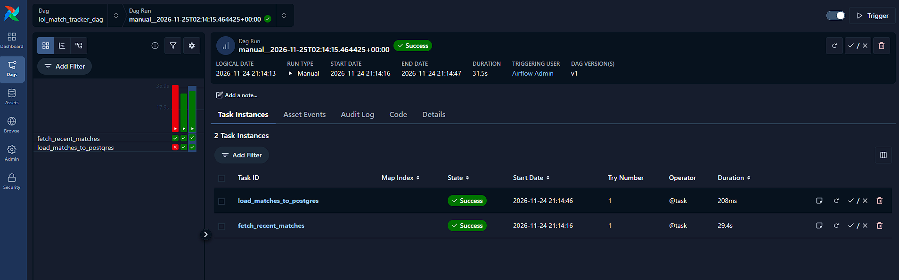

# League of Legends Match & Champion Analytics Pipeline

An end-to-end ELT data pipeline built with **Apache Airflow**, **PostgreSQL**, **Docker**, and **dbt** to ingest match history from the Riot Games API, store idempotent raw match records, and transform them into clean analytics models with automated data quality tests.

## Architecture

1. **Extract & Load (Airflow + PostgreSQL):**
   - `lol_match_tracker_dag` resolves a player's PUUID via the Riot Account API, fetches recent match IDs and match stats, and loads them into PostgreSQL (`public.raw_lol_matches`).
   - Uses `ON CONFLICT DO NOTHING` upserts so scheduled or manual runs remain idempotent without creating duplicate match records.
2. **Transform (dbt):**
   - `analytics.stg_lol_matches` — cleans, casts, and normalizes raw match fields into a typed staging view.
   - `analytics.fct_champion_winrate` — aggregates games played, wins, losses, win rate percentage, and average KDA metrics per champion.
3. **Data Quality Testing (dbt):**
   - Automated schema tests (`unique`, `not_null`) validate primary keys and critical metrics across staging and mart models (`PASS=7`).

   

## Sample Output (`analytics.fct_champion_winrate`)

```sql
SELECT *
FROM analytics.fct_champion_winrate
ORDER BY games_played DESC, win_rate_pct DESC
LIMIT 5;
```

| champion_name | games_played | wins | losses | win_rate_pct | avg_kills | avg_deaths | avg_assists | kda_ratio |
| :--- | :---: | :---: | :---: | :---: | :---: | :---: | :---: | :---: |
| Leona | 4 | 2 | 2 | 50.0 | 2.0 | 4.8 | 17.3 | 4.05 |
| Senna | 4 | 1 | 3 | 25.0 | 2.0 | 7.8 | 13.8 | 2.03 |
| Jinx | 4 | 1 | 3 | 25.0 | 4.3 | 4.5 | 4.0 | 1.83 |
| Braum | 4 | 0 | 4 | 0.0 | 0.8 | 2.5 | 3.8 | 1.80 |
| Rell | 2 | 2 | 0 | 100.0 | 4.5 | 1.5 | 17.5 | 14.67 |

## Project Structure

```text
lol-airflow-dbt-pipeline/
├── airflow/
│   ├── config/               # Airflow configuration
│   ├── dags/
│   │   └── lol_match_tracker_dag.py
│   ├── docker-compose.yaml   # Airflow + PostgreSQL services
│   └── .env.example          # Required environment variable template
├── dbt/
│   ├── models/
│   │   ├── sources.yml
│   │   ├── stg_lol_matches.sql
│   │   ├── fct_champion_winrate.sql
│   │   └── schema.yml        # Automated dbt data tests
│   └── dbt_project.yml
└── README.md
```

## How to Run Locally

1. **Configure environment variables:**
   ```bash
   cd airflow
   cp .env.example .env
   # Add your RIOT_API_KEY, RIOT_GAME_NAME, and RIOT_TAG_LINE to .env
   ```

2. **Start Airflow and PostgreSQL:**
   ```bash
   docker compose up -d
   ```

3. **Trigger the ELT pipeline:**
   - Open the Airflow UI at `http://localhost:8080`, unpause `lol_match_tracker_dag`, and trigger a run.

4. **Run dbt transformations and tests:**
   ```bash
   cd ../dbt
   dbt run
   dbt test
   ```